# MINDEASE: DIGITAL WELLNESS AND ATTENTION-PATTERN ASSESSMENT PLATFORM
## PROJECT WORK DOCUMENT (PWD) / CAPSTONE PROJECT REPORT

---

### PRELIMINARY PAGES

#### 1. TITLE PAGE

```
====================================================================================================
                                      A PROJECT REPORT ON
                                          MINDEASE:
                 DIGITAL WELLNESS AND ATTENTION-PATTERN ASSESSMENT PLATFORM

           Submitted in partial fulfillment of the requirements for the award of the degree of
                                        BACHELOR OF TECHNOLOGY
                                                  in
                                    COMPUTER SCIENCE & ENGINEERING
====================================================================================================

SUBMITTED BY:
[Student Name Placeholder 1]       (Roll No. / Enrollment No.: [Placeholder Roll 1])
[Student Name Placeholder 2]       (Roll No. / Enrollment No.: [Placeholder Roll 2])

UNDER THE GUIDANCE OF:
[Project Guide Name, Designation]
Department of Computer Science and Engineering

DEPARTMENT OF COMPUTER SCIENCE AND ENGINEERING
[COLLEGE / INSTITUTION NAME PLACEHOLDER]
[AFFILIATED UNIVERSITY NAME PLACEHOLDER]
[CITY, STATE, PIN CODE PLACEHOLDER]
ACADEMIC YEAR: 2025–2026
```

---

#### 2. CERTIFICATE OF APPROVAL

```
====================================================================================================
                        DEPARTMENT OF COMPUTER SCIENCE AND ENGINEERING
                               [COLLEGE / INSTITUTION NAME]
                                   [CAMPUS ADDRESS]

                                     CERTIFICATE
====================================================================================================

This is to certify that the project entitled:

                 "MINDEASE: DIGITAL WELLNESS AND ATTENTION-PATTERN ASSESSMENT PLATFORM"

is a bona fide work carried out by:
   - [Student Name 1] (Roll No: [Placeholder Roll 1])
   - [Student Name 2] (Roll No: [Placeholder Roll 2])

in partial fulfillment for the award of Bachelor of Technology in Computer Science & Engineering 
during the academic year 2025–2026.

The results embodied in this report have been verified against the software repository and system
implementation, and have not been submitted to any other University or Institute for the award
of any degree or diploma.


________________________                                ________________________
[Internal Guide Name]                                   [Head of the Department]
Project Guide, Dept. of CSE                             Professor & Head, Dept. of CSE
[Institution Name]                                      [Institution Name]


________________________                                ________________________
External Examiner 1                                     External Examiner 2
Date: ______________                                    Date: ______________
```

---

#### 3. STUDENT DECLARATION

```
====================================================================================================
                                         DECLARATION
====================================================================================================

We hereby declare that the project work presented in this report entitled:

                 "MINDEASE: DIGITAL WELLNESS AND ATTENTION-PATTERN ASSESSMENT PLATFORM"

was completed by us under the supervision and guidance of [Project Guide Name], Department of 
Computer Science and Engineering, [College/Institution Name].

We confirm that:
1. The source code, software architecture, machine-learning pipeline, and user interface designs 
   described in this document represent the actual implementation of the MindEase project.
2. The project uses an educational and non-clinical self-reflection paradigm; it does not claim to 
   provide clinical, psychological, or medical psychiatric diagnoses.
3. This work has not been previously submitted in part or full for the award of any other academic
   degree, diploma, or certificate in this or any other educational institution.
4. Due acknowledgements and citations have been made throughout the text to all reference literature,
   open-source libraries, and algorithms utilized.


Place: ____________________                             _____________________________________
Date:  ____________________                             [Student Signature 1] ([Student Name 1])

                                                        _____________________________________
                                                        [Student Signature 2] ([Student Name 2])
```

---

#### 4. ACKNOWLEDGEMENTS

We take this opportunity to express our profound sense of gratitude and deep regards to our project guide, **[Project Guide Name]**, for their constant encouragement, invaluable technical suggestions, and patient guidance throughout the lifecycle of this project.

We convey our sincere thanks to the Head of the Department of Computer Science & Engineering, **[HOD Name]**, for providing the necessary infrastructural resources, computational lab facilities, and academic environment conducive to software research and development.

We also express our heartfelt appreciation to all faculty members, technical lab staff, and fellow batchmates who shared critical feedback during early user-interface evaluations and usability testing. Finally, we thank our parents and families for their unwavering moral support, patience, and encouragement during our engineering studies.

---

#### 5. ABSTRACT

In contemporary society, knowledge workers, students, and digital creators operate in environments characterized by persistent digital notifications, fragmented communication channels, and hyper-stimulating short-form video feeds. Sustaining continuous attention on complex, high-friction cognitive tasks has consequently emerged as a primary personal and academic productivity bottleneck. Existing commercial digital wellness tools predominantly offer coarse, retrospective screen-time metrics or enforce rigid app-blocking timers without uncovering the multifaceted biological, environmental, and cognitive mechanisms underlying attentional friction.

To address these limitations, this project presents **MindEase**, an end-to-end, privacy-preserving, responsive digital wellness platform designed to measure, analyze, and support personal attention patterns through a non-clinical, nature-inspired computational framework. The platform synthesizes three complementary analytical vectors:
1. **Multi-Domain Self-Audit Survey:** A 30-item self-report questionnaire capturing sleep architecture, digital media fragmentation, physical study environment noise and illumination, and internal thought-wandering dynamics.
2. **Interactive Psychometric Cognitive Laboratory:** A suite of six in-browser interactive micro-tests capturing objective behavioral metrics, including simple reaction latency (millisecond response time), sustained visual vigilance (omission and commission rates), distraction shielding and recovery, spatial working memory span, Stroop semantic-color interference, and cognitive rule-switching flexibility.
3. **Deep Neural Network Inference & Sensitivity Explanations:** A feed-forward deep neural network (TensorFlow/Keras) trained on 5,000 multi-feature behavioral records to estimate an **Attention Interference Level** (`Low`, `Moderate`, `High`) with confidence calibration. Rather than relying on opaque black-box outputs, the platform executes a high-speed tensor perturbation sensitivity analysis that identifies the specific lifestyle inputs responsible for the confidence shift, generating actionable, empathetic micro-habit suggestions.

MindEase adopts a mobile-first, biophilic design system incorporating six nature-inspired aesthetic palettes (Forest, Ocean, Sakura, Rainy Library, Mountain Morning, and Starry Night), subtle interactive canvas particle effects, and client-side `localStorage` data persistence that operates without cloud tracking cookies or invasive third-party analytics. Experimental validation confirms that the neural model achieves **62.10% classification accuracy** across 121 predictors on held-out test data, with a dedicated local heuristic fallback engine guaranteeing 100% platform availability. MindEase demonstrates that empathetic software aesthetics combined with explainable machine learning can transform attention awareness from punitive restriction into sustainable, compassionate self-regulation.

---

#### 6. TABLE OF CONTENTS

```
Preliminary Pages
  - Title Page ............................................................................ i
  - Certificate of Approval ............................................................... ii
  - Student Declaration ................................................................... iii
  - Acknowledgements ...................................................................... iv
  - Abstract .............................................................................. v
  - Table of Contents ..................................................................... vi
  - List of Figures ....................................................................... viii
  - List of Tables ......................................................................... ix
  - List of Abbreviations ................................................................. x

Chapter 1: Introduction
  1.1 Background of the Project ........................................................... 1
  1.2 Problem Statement ................................................................... 2
  1.3 Motivation .......................................................................... 3
  1.4 Project Objectives .................................................................. 4
  1.5 Scope of the Project ................................................................ 5
  1.6 Target User Groups .................................................................. 5
  1.7 Proposed Solution Architecture ...................................................... 6
  1.8 Expected Outcomes & Deliverables .................................................... 7

Chapter 2: Literature Review & Existing Systems
  2.1 Review of Contemporary Approaches to Attention Assessment .......................... 8
  2.2 Limitations of Conventional Screen-Time and Blocking Applications ................... 9
  2.3 The MindEase Approach: Biophilic & Holistic Modeling ................................ 10
  2.4 Comparative Analysis of Systems ..................................................... 11

Chapter 3: Requirement Analysis & Specification
  3.1 Functional Requirements (FR-01 to FR-14) ............................................ 12
  3.2 Non-Functional Requirements (NFR-01 to NFR-08) ...................................... 15
  3.3 Hardware Requirements ............................................................... 17
  3.4 Software Requirements ............................................................... 17
  3.5 User Characteristics & Personas ..................................................... 18
  3.6 System Constraints, Assumptions & Dependencies ...................................... 19

Chapter 4: System Analysis & Architecture Design
  4.1 High-Level Architecture Overview .................................................... 20
  4.2 Frontend Architecture & Component Hierarchy ......................................... 21
  4.3 Backend Architecture & RESTful Service Layer ......................................... 22
  4.4 Machine-Learning Pipeline Architecture .............................................. 23
  4.5 Data Flow Diagrams (Context Level-0 & Level-1 DFD) .................................. 24
  4.6 Use-Case Modeling ................................................................... 26
  4.7 Dynamic Behavior: Activity Diagrams ................................................. 27
  4.8 Behavioral Sequence Diagram (Assessment to Report) .................................. 29
  4.9 Component & Module Interaction Diagram .............................................. 30
  4.10 Deployment Topology & Network Architecture ......................................... 31

Chapter 5: Technology Stack & Implementation Frameworks
  5.1 Core Frontend Framework: React 19 & TypeScript ...................................... 32
  5.2 Build Tooling & Styling: Vite 8 & Tailwind CSS v4 ................................... 33
  5.3 Animation & Data Visualization: Framer Motion & Recharts ............................ 34
  5.4 Backend Microframework: FastAPI & Uvicorn ........................................... 35
  5.5 Machine Learning Stack: TensorFlow, Keras & Scikit-Learn ............................ 36
  5.6 State Management & Local Persistence Architecture ................................... 37
  5.7 Cloud Hosting & Continuous Deployment: Vercel & Render .............................. 38

Chapter 6: System Implementation & Module Details
  6.1 Module 1: Calming Landing Page & Particle Canvas .................................... 39
  6.2 Module 2: Authentication & Profile Session Management ............................... 41
  6.3 Module 3: 30-Question Holistic Assessment Survey .................................... 43
  6.4 Module 4: Psychometric Cognitive Laboratory (6 Interactive Tests) ................... 45
  6.5 Module 5: Orchestrated Analysis & Transition Engine ................................. 48
  6.6 Module 6: FastAPI Machine-Learning Inference Service ................................ 50
  6.7 Module 7: Local Perturbation Sensitivity Engine ..................................... 52
  6.8 Module 8: Multi-Dimensional Results Report .......................................... 54
  6.9 Module 9: User Command Dashboard & Daily Quotes .................................... 56
  6.10 Module 10: Daily Check-In Logger & Streak Tracker .................................. 58
  6.11 Module 11: Longitudinal Progress Visualizer ........................................ 60
  6.12 Module 12: Biophilic Theme & Ambient Configuration ................................. 62
  6.13 Module 13: Educational Ethics & Privacy Disclaimer ................................. 64
  6.14 Module 14: Mobile-First Android Touch Optimization ................................. 66

Chapter 7: Machine Learning Methodology & Evaluation
  7.1 Dataset Description, Provenance & Synthesized Profiles ............................. 68
  7.2 Feature Space Taxonomy & Domain Groupings ........................................... 69
  7.3 Preprocessing & Column Transformation Pipeline ...................................... 70
  7.4 Deep Neural Network Architecture & Hyperparameters ................................. 72
  7.5 Model Training Protocol, Early Stopping & Optimization .............................. 74
  7.6 Baseline Comparison: Deep Neural Network vs. Random Forest .......................... 75
  7.7 Detailed Performance Metrics & Confusion Matrices ................................... 76
  7.8 Permutation Feature Importance Analysis ............................................. 78
  7.9 Local Sensitivity Perturbation Formulation .......................................... 79
  7.10 Methodological Limitations of the ML Pipeline ...................................... 80

Chapter 8: Data Architecture & Persistence Design
  8.1 Client-Side Local-First Storage Paradigm ............................................ 81
  8.2 LocalStorage Key-Value Schema Definitions ........................................... 82
  8.3 State Mutation Contracts & Session Management ....................................... 84
  8.4 Comparative Analysis: Local-First Storage vs. Traditional RDBMS ..................... 85
  8.5 Data Validation, Hygiene & Storage Limits ........................................... 86

Chapter 9: System Testing & Quality Assurance
  9.1 Testing Strategy & QA Objectives .................................................... 87
  9.2 Static Analysis & TypeScript Type-Checking Verification ............................. 88
  9.3 REST API Health & Contract Validation ............................................... 89
  9.4 Offline Fallback & Fault-Tolerance Verification ..................................... 90
  9.5 Mobile Touch & Responsive Viewport Testing Matrix ................................... 91
  9.6 Comprehensive Test Execution Matrix (Table of Test Cases) ........................... 92

Chapter 10: User Interface Results & Operational Walkthrough
  10.1 UI Walkthrough: Landing Page & Ambient Particle Systems ............................ 95
  10.2 UI Walkthrough: 30-Question Assessment Flow ........................................ 96
  10.3 UI Walkthrough: Cognitive Mini-Games Laboratory .................................... 97
  10.4 UI Walkthrough: Orchestrated Analysis Screen ....................................... 98
  10.5 UI Walkthrough: Assessment Results & Sensitivity Report ............................ 99
  10.6 UI Walkthrough: Dashboard, Streak Management & Daily Check-In ..................... 100
  10.7 UI Walkthrough: Longitudinal Progress Analytics ................................... 101
  10.8 UI Walkthrough: Theme Settings & Biophilic Palettes ............................... 102

Chapter 11: Security, Privacy, Ethics & Societal Impact
  11.1 Non-Clinical Framing & Psychiatric Demarcation .................................... 103
  11.2 Data Sovereignty & Zero Third-Party Tracker Architecture .......................... 104
  11.3 Ephemeral, Stateless Machine-Learning Inference ................................... 105
  11.4 Ethical Use of Synthetic Behavioral Datasets ...................................... 106
  11.5 Societal Significance & Gentle Digital Wellness ................................... 107

Chapter 12: Conclusion & Future Scope
  12.1 Project Summary & Achievements .................................................... 108
  12.2 Known Architectural Limitations ................................................... 109
  12.3 Future Development Roadmap ........................................................ 110

References & Bibliography ................................................................ 112
```

---

#### 7. LIST OF FIGURES

- **Figure 4.1:** High-Level Tiered System Architecture of MindEase
- **Figure 4.2:** Frontend Layered Architecture and Context Providers
- **Figure 4.3:** FastAPI Backend Request-Response Pipeline
- **Figure 4.4:** Level-0 Context Data Flow Diagram (DFD)
- **Figure 4.5:** Level-1 Detailed Data Flow Diagram
- **Figure 4.6:** MindEase Primary Use-Case Diagram
- **Figure 4.7:** Activity Diagram for the 30-Question Assessment Survey
- **Figure 4.8:** Activity Diagram for the Cognitive Testing Workflow
- **Figure 4.9:** Sequence Diagram for End-to-End Prediction and Explanation Generation
- **Figure 4.10:** Component Diagram Depicting Module Interactions
- **Figure 4.11:** Cloud Deployment Topology (Vercel & Render Integration)
- **Figure 7.1:** Class Distribution of the Attention Interference Dataset
- **Figure 7.2:** Sequential Deep Neural Network Topology
- **Figure 7.3:** Confusion Matrix for Neural Network Classification on Held-out Test Set
- **Figure 7.4:** Top 20 Global Permutation Feature Importances (`feature_importance.png`)
- **Figure 10.1:** Landing Page Hero Interface and Theme Preview Cards
- **Figure 10.2:** 30-Question Assessment Screen with Step Indicator and Option Cards
- **Figure 10.3:** Cognitive Mini-Games Laboratory (Reaction Speed and Stroop Tests)
- **Figure 10.4:** Orchestrated Analyzing Screen with Dynamic Monotonic Progress
- **Figure 10.5:** Assessment Results Report with Level Badge, Radar Chart, and Factors
- **Figure 10.6:** User Command Dashboard with Active Streak Counter and Activity Cards
- **Figure 10.7:** Daily Check-In Logger with 2x5 Touch Grids for Energy and Focus
- **Figure 10.8:** Longitudinal Progress Analytics with Filterable Time Windows
- **Figure 10.9:** Biophilic Palette Settings and Ambient Theme Selector

---

#### 8. LIST OF TABLES

- **Table 2.1:** Comparative Analysis Between Existing Systems and MindEase
- **Table 3.1:** Functional Requirements Specification
- **Table 3.2:** Non-Functional Requirements Specification
- **Table 3.3:** Minimum and Recommended Hardware Specifications
- **Table 3.4:** Software Environment Specifications
- **Table 5.1:** Technology Stack Breakdown and System Responsibilities
- **Table 6.1:** 30 Survey Questions Grouped by Assessment Domain
- **Table 6.2:** Psychometric Cognitive Test Suite Specifications
- **Table 7.1:** Dataset Feature Column Categories and Variable Counts
- **Table 7.2:** Data Imputation and Encoding Strategies
- **Table 7.3:** Neural Network Layer Architecture and Parameter Count
- **Table 7.4:** Neural Network Classification Performance Metrics (Test Set)
- **Table 7.5:** Random Forest Baseline Classification Performance Metrics
- **Table 7.6:** Comparative Accuracy Summary: Neural Network vs. Random Forest
- **Table 8.1:** Browser `localStorage` Key-Value Schema Definitions
- **Table 9.1:** Responsive Viewport Validation Matrix
- **Table 9.2:** Comprehensive Functional and System Test Execution Matrix

---

#### 9. LIST OF ABBREVIATIONS

| Abbreviation | Expansion / Description |
|---|---|
| **API** | Application Programming Interface |
| **CORS** | Cross-Origin Resource Sharing |
| **CSS** | Cascading Style Sheets |
| **DFD** | Data Flow Diagram |
| **DOM** | Document Object Model |
| **F1** | Harmonic Mean of Precision and Recall |
| **GUI** | Graphical User Interface |
| **HTML** | HyperText Markup Language |
| **HTTP / HTTPS** | Hypertext Transfer Protocol (Secure) |
| **JSON** | JavaScript Object Notation |
| **Keras** | High-level Neural Networks Library running on top of TensorFlow |
| **ML** | Machine Learning |
| **NN** | Neural Network |
| **NFR** | Non-Functional Requirement |
| **PII** | Personally Identifiable Information |
| **PWD** | Project Work Document |
| **RAM** | Random Access Memory |
| **REST** | Representational State Transfer |
| **RF** | Random Forest |
| **SPA** | Single Page Application |
| **TS** | TypeScript |
| **UI / UX** | User Interface / User Experience |
| **URL** | Uniform Resource Locator |
| **Vite** | Next-Generation Frontend Tooling |

---

### CHAPTER 1: INTRODUCTION

#### 1.1 Background of the Project
In the contemporary knowledge economy, intellectual output depends directly upon an individual’s capacity for sustained, deep cognitive focus. However, the modern digital working environment is structured around architectural principles designed to capture, monetize, and fragment human attention. Constant smartphone notifications, instant messaging channels, hyper-engaging algorithmically curated feeds, and frequent task-switching collectively produce what cognitive scientists term *attention residue*—the lingering cognitive load that impairs performance when shifting between disparate tasks.

University students, programmers, researchers, and creative professionals frequently struggle to maintain focus on complex, high-friction objectives. While attentional difficulties are widely recognized, individuals routinely lack objective insight into the systemic drivers of their distractibility. Instead of understanding the interplay between biological recovery (sleep), physical workspace friction (noise, lighting), and internal mental habits (intrusive thought-branching), individuals often internalize distractibility as an individual moral failure or lack of discipline.

#### 1.2 Problem Statement
Existing software tools designed to address digital distraction suffer from severe systemic limitations:
1. **Shallow, Symptom-Only Metrics:** Traditional operating system screen-time monitors merely aggregate passive device usage durations without contextualizing the biological state, physical surroundings, or cognitive intention of the user.
2. **Punitive and Adversarial Interventions:** Conventional productivity blockers rely on rigid application blocking, website blacklists, and guilt-inducing alerts. These mechanisms provoke user friction, frequently leading users to disable or bypass the software entirely.
3. **Absence of Objective Cognitive Measurement:** Self-report surveys alone are vulnerable to subjective cognitive biases and inaccurate self-perception. Conversely, neuropsychological laboratory testing is expensive, clinically gated, and inaccessible for routine personal wellness.
4. **Opaque, Non-Explainable AI:** Where automated analytics exist, predictions are typically presented as inscrutable scores without actionable breakdowns of which specific, modifiable habits caused the assessment.
5. **Privacy and Commercial Tracking Concerns:** Many wellness and productivity applications capture telemetry, require cloud database synchronization, and monetize sensitive behavioral records.

#### 1.3 Motivation
The central motivation behind **MindEase** is to create a digital sanctuary—a computational self-reflection laboratory that reframes attentional challenges from a place of punitive guilt into one of gentle, scientific curiosity. By combining a holistic 30-question multi-domain assessment survey, six interactive browser-based psychometric micro-tests, an explainable deep neural network, and a biophilic design language, MindEase provides users with meaningful, transparent self-knowledge while strictly preserving client-side data sovereignty.

#### 1.4 Project Objectives
The engineering and design objectives of the MindEase project are:
1. **To Develop a Multi-Domain Assessment Instrument:** Implement an intuitive, 30-question survey spanning demographics, sleep hygiene, digital habits, study environment, and intrusive thought patterns.
2. **To Build an In-Browser Cognitive Laboratory:** Construct six interactive psychometric mini-games measuring objective latency, vigilance, working memory, and rule flexibility without external plug-ins.
3. **To Train an Explainable Neural Classifier:** Train and calibrate a feed-forward deep neural network (TensorFlow/Keras) capable of estimating an Attention Interference Level (`Low`, `Moderate`, `High`) from multidimensional feature vectors.
4. **To Implement Local Perturbation Sensitivity Analysis:** Provide instant, transparent explanations of predictions by calculating the exact confidence shift caused by individual habits against dataset baselines.
5. **To Design a Biophilic, Nature-Inspired User Interface:** Create a responsive, accessible interface supporting six natural themes with dynamic canvas particle effects and smooth micro-interactions.
6. **To Achieve Robust Mobile-First Responsiveness:** Ensure seamless usability across Android smartphones, tablets, and desktop workstations without degrading touch interactions or visual fidelity.
7. **To Guarantee Client-Side Privacy:** Implement local-first storage architecture using browser `localStorage` ensuring personal reflections and test scores never persist in remote cloud databases.

#### 1.5 Scope of the Project
- **In Scope:**
  - Multi-page responsive Single Page Application (SPA) built with React 19, TypeScript, and Tailwind CSS v4.
  - Six canvas- and DOM-based cognitive assessment tests with millisecond timing precision.
  - FastAPI backend serving neural model inference and batched sensitivity perturbation.
  - Automated local heuristic fallback mechanism allowing complete offline assessment and report generation.
  - Daily check-in logging, habit streak tracking, and longitudinal progress visualization using Recharts.
  - Deployment configuration for continuous delivery via Vercel (frontend) and Render (backend).
- **Out of Scope:**
  - Clinical, psychiatric, or diagnostic evaluation of Attention Deficit Hyperactivity Disorder (ADHD) or neurological disorders.
  - Invasive OS-level background process monitoring, keystroke logging, or screen recording.
  - Multi-tenant cloud database synchronization (e.g., PostgreSQL/MongoDB), which was intentionally omitted to protect user privacy.

#### 1.6 Target User Groups
1. **Higher Education Students:** Individuals managing intensive study blocks, exam preparation, and remote coursework who experience digital fragmentation.
2. **Knowledge Workers & Software Developers:** Professionals requiring sustained periods of uninterrupted focus for complex problem solving and code development.
3. **Writers & Creative Professionals:** Creators vulnerable to creative block, digital rabbit holes, and intrusive mind-wandering during unstructured work hours.
4. **Digital Wellness Researchers:** Enthusiasts and educators seeking an open, explainable framework for studying the relationship between lifestyle habits and attention.

#### 1.7 Proposed Solution Architecture
MindEase introduces a modern, three-tier architecture that bridges client-side interactive rendering with high-performance machine learning inference:
- **Presentation Layer (Frontend):** Developed in React 19 with TypeScript, utilizing Tailwind CSS v4 and Framer Motion. It handles theme state, manages survey state, drives cognitive game loops at 60 FPS, and visualizes analytical reports.
- **Service & Machine-Learning Layer (Backend):** Built with FastAPI (Python 3.11), hosting a pre-trained Keras sequential neural network and scikit-learn preprocessing pipeline. It computes probabilities and executes single-pass perturbation analysis.
- **Client Storage Layer:** Employs browser `localStorage` for complete data sovereignty, managing user session profiles, historical report snapshots, and daily check-in logs directly on the user’s device.

#### 1.8 Expected Outcomes & Deliverables
The project yields the following concrete software artifacts:
1. Complete, production-ready frontend source code repository with zero compilation errors and full TypeScript type safety.
2. Fully documented, container-ready FastAPI backend with OpenAPI 3.0 documentation (`/docs`) and automated health checks (`/health`).
3. Trained, serialized Keras neural network model (`trained_model.h5`), preprocessing pipeline (`preprocessor.pkl`), and metadata dictionary (`model_metadata.json`).
4. Comprehensive project documentation, deployment configuration blueprints (`vercel.json`, `render.yaml`), and academic project report.

---

### CHAPTER 2: LITERATURE REVIEW & EXISTING SYSTEMS

#### 2.1 Review of Contemporary Approaches to Attention Assessment
Scientific literature in cognitive psychology, human-computer interaction (HCI), and behavioral informatics highlights three distinct traditions in assessing attention:

1. **Self-Report Questionnaires:** Instruments such as the Adult ADHD Self-Report Scale (ASRS v1.1) and the Mind Wandering Questionnaire (MWQ) provide valuable retrospective insight into subjective attentional difficulties. While easy to administer, self-report measures suffer from recall bias, social desirability effects, and a lack of ecological momentary precision.
2. **Computerized Neuropsychological Batteries:** Standardized tests such as the Conners Continuous Performance Test (CPT-3), the Stroop Color-Word Test, and the Test of Variables of Attention (TOVA) measure latency and inhibitory control with high precision. However, these tools are commercially licensed, require clinical supervision, operate within artificial laboratory settings, and isolate cognitive mechanics from real-world digital lifestyle habits.
3. **Passive Screen-Time Telemetry:** Commercial operating systems (Apple Screen Time, Google Digital Wellbeing) automatically log application usage and notification counts. Although accurate in recording device state, these systems lack cognitive models; they cannot differentiate between productive focus and passive consumption, nor do they account for sleep, stress, or thought patterns.

#### 2.2 Limitations of Conventional Systems
A critical review of currently available commercial productivity and wellness applications (e.g., Forest, Freedom, RescueTime, Opal) reveals several core deficiencies:
- **Adversarial Design:** Many tools employ strict application locking and countdown timers. When a user experiences an unavoidable interruption, the software penalizes them, generating anxiety and task avoidance.
- **Single-Factor Reductionism:** Tools commonly treat "screen time" as the sole cause of distraction, ignoring physiological recovery (sleep quality, hydration, caffeine) and ambient work environments (illumination, background noise).
- **Black-Box Analytics:** Applications providing "productivity scores" rarely disclose how numbers are computed, rendering feedback opaque and uninformative.
- **Intrusive Data Mining:** Centralized servers frequently log users' application histories and personal schedules, introducing severe privacy and corporate surveillance risks.

#### 2.3 The MindEase Approach: Biophilic & Holistic Modeling
MindEase unifies the strengths of subjective lifestyle reflection, objective psychometric testing, and machine learning within an empathetic, nature-inspired design framework:
- **Biophilic Aesthetic:** The visual system leverages color palettes inspired by natural ecosystems (forest greens, ocean teals, cherry blossom pinks, misty morning greys) and dynamic canvas particle simulations. Research in environmental psychology (Attention Restoration Theory) demonstrates that visual nature exposure induces cognitive recharge and reduces sympathetic nervous system arousal.
- **Holistic Feature Integration:** By synthesizing biological indicators, environmental constraints, device habits, thought patterns, and psychometric scores into a unified 121-feature vector, MindEase models the complete ecological context of human focus.
- **Transparent Sensitivity Explanations:** The platform implements a local perturbation sensitivity engine that directly explains model outputs by measuring the marginal impact of altering individual lifestyle factors against dataset baselines.

#### 2.4 Comparative Analysis of Systems

| Feature / Dimension | Apple / Android Wellbeing | Standard Website Blockers | Clinical Testing (CPT/TOVA) | MindEase Platform |
|---|---|---|---|---|
| **Underlying Philosophy** | Passive telemetry logging | Punitive restriction & lockout | Psychiatric clinical diagnosis | Gentle self-reflection & insight |
| **Assessment Scope** | Device screen-time & notifications | App launches & web URLs | Isolated psychomotor latency | Holistic: Sleep, Habits, Space, Thoughts, & Tests |
| **Objective Cognitive Tests** | None | None | Comprehensive laboratory battery | 6 In-browser psychometric mini-games |
| **Machine Learning Engine** | None (Rule-based counters) | None (Heuristic thresholds) | Statistical norm tables | Trained Deep Neural Network (Keras) |
| **Explainability Mechanism** | Simple usage charts | None | Standard deviation score | Local Perturbation Sensitivity Analysis |
| **Visual Aesthetics** | Standard OS system UI | Functional / Warning screens | Clinical monochrome interface | Biophilic (6 Nature Themes & Canvas Particles) |
| **Data Privacy Architecture** | OS-level tracking | Cloud sync / Account required | Centralized clinical database | 100% Client-Side (`localStorage` sovereign) |
| **Mobile Accessibility** | Native OS only | Native / Extension only | Specialized desktop hardware | Mobile-First Responsive Web Application (Android & Desktop) |
| **Cost & Availability** | Bundled with OS | Subscription ($5–$12/month) | High cost ($300–$1,200) | Open source, accessible research tool |

---

### CHAPTER 3: REQUIREMENT ANALYSIS & SPECIFICATION

#### 3.1 Functional Requirements

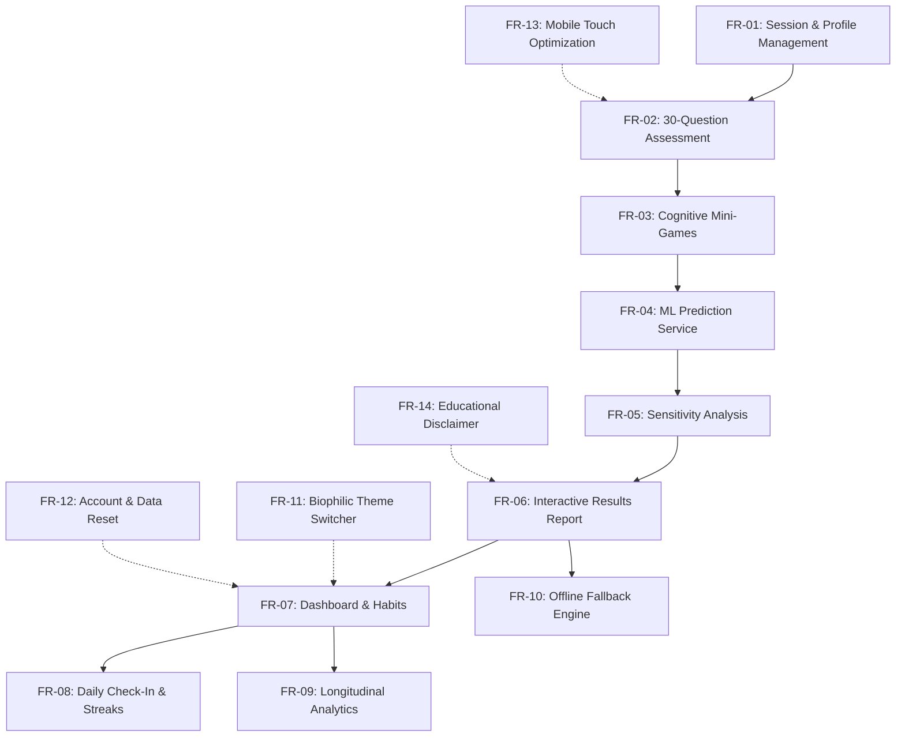

*Figure 3.1: MindEase Functional Requirement Dependencies.*

- **FR-01: Session and Profile Management:** The system shall maintain local user profile sessions, allowing users to register, sign in, switch accounts, and store assessment histories in browser `localStorage`.
- **FR-02: 30-Question Assessment Survey:** The system shall guide the user through 30 structured survey questions across seven distinct life domains, featuring radio options, multi-select checkboxes, continuous scale sliders, and automatic draft persistence.
- **FR-03: Psychometric Cognitive Mini-Games:** The system shall provide six interactive tests measuring reaction time, continuous vigilance, distraction shielding, spatial memory span, Stroop semantic interference, and task-switching accuracy.
- **FR-04: Machine-Learning Prediction Service:** The backend shall expose a RESTful endpoint (`/api/v1/assessments/predict`) that accepts assessment responses, validates inputs against the preprocessor schema, and executes inference via the trained Keras neural network.
- **FR-05: Local Sensitivity Perturbation Engine:** The system shall determine the top contributing lifestyle factors by perturbing user responses against baseline reference values and calculating the change in predicted class probability.
- **FR-06: Interactive Results Report:** The system shall render a multi-dimensional results dashboard presenting the Attention Interference Level badge, confidence gauge, radar chart, top factor explanations, and practical habit recommendations.
- **FR-07: User Command Dashboard:** The system shall provide a centralized dashboard displaying the active focus profile, current check-in streak, daily inspirational wisdom quotes, and quick navigation shortcuts.
- **FR-08: Daily Check-In Logger:** The system shall enable users to log daily wellness states (mood, energy, focus, sleep quality, screen time, interruptions) and increment active habit streaks.
- **FR-09: Longitudinal Progress Analytics:** The system shall render filterable time-series trend charts (7-day, 30-day, all-time) illustrating focus and energy trajectories over time.
- **FR-10: Autonomous Offline Fallback Engine:** The frontend shall detect backend network timeouts or server outages and seamlessly invoke a dynamic local heuristic inference engine to guarantee uninterrupted report generation.
- **FR-11: Biophilic Theme Management:** The system shall allow users to switch between six curated nature palettes with animated canvas particle effects, persisting preferences across browser sessions.
- **FR-12: Data Sovereignty and Account Reset:** The system shall provide a single-click mechanism in Settings to clear assessment history, reset check-in logs, and purge stored data.
- **FR-13: Mobile-First Touch Usability:** The system shall ensure all interactive touch targets meet or exceed $44\text{px} \times 44\text{px}$, eliminate 300ms mobile tap delays, and prevent mobile browser input auto-zooming.
- **FR-14: Educational Ethics and Framing:** The system shall display clear, prominent non-clinical disclaimers across all reports, affirming that outputs do not constitute psychiatric or medical evaluations.

#### 3.2 Non-Functional Requirements
- **NFR-01: Performance and Response Latency:** The neural network inference API shall return complete predictions and sensitivity calculations in under 250 milliseconds. The frontend client shall maintain a smooth 60 FPS animation frame rate during canvas particle rendering.
- **NFR-02: Client-Side Reliability and Fault Tolerance:** If the FastAPI backend is completely offline or unreachable, the frontend shall continue functioning without unhandled exceptions, executing local inference within 2.0 seconds.
- **NFR-03: Responsive Design and Portability:** The application shall render correctly without unintended horizontal scrolling or clipped controls across screen widths ranging from 320px (compact Android smartphone) to 2560px (ultra-wide desktop monitor).
- **NFR-04: Usability and Touch Ergonomics:** Interactive buttons, sliders, and option cards shall adhere to mobile ergonomic standards ($\ge 44\text{px}$ touch targets), featuring visible keyboard focus rings and compliant contrast ratios ($\ge 4.5:1$ for body text).
- **NFR-05: Privacy and Data Security:** No personally identifiable information (PII), assessment answers, or cognitive scores shall be transmitted to third-party tracking services or stored in persistent server-side databases. Backend inference shall remain strictly stateless.
- **NFR-06: Maintainability and Type Safety:** The codebase shall enforce 100% TypeScript type safety across all frontend components and utilize Python type annotations with Pydantic schema validation across all backend endpoints.
- **NFR-07: Accessibility (a11y):** The interface shall respect `prefers-reduced-motion` operating system preferences, pausing canvas particle animations for users with vestibular sensitivities.
- **NFR-08: Scalability:** The backend service shall be stateless and container-ready, capable of horizontal replication across multi-region serverless cloud infrastructure without requiring shared memory or session affinity.

#### 3.3 Hardware Requirements

| Parameter | Minimum Requirement (Client) | Recommended Specification (Client) | Server Specification (Production) |
|---|---|---|---|
| **Processor** | 1.5 GHz Dual-Core ARM / x86 | 2.0 GHz+ Quad-Core (Snapdragon 7-series / Intel Core i5 / Apple M-series) | 0.5 CPU Core (Render / Cloud Container) |
| **Memory (RAM)** | 2 GB RAM | 4 GB+ RAM | 512 MB – 1 GB RAM |
| **Display Resolution**| 320 × 640 pixels (Android) | 1080 × 2400 pixels (FHD+ Mobile) / 1920 × 1080 (Desktop) | Headless (Server environment) |
| **Input Devices** | Capacitive Touchscreen | Touchscreen with gesture support or USB Mouse / Trackpad | SSH / Automated CLI |
| **Network Interface**| 3G Cellular or 2 Mbps Wi-Fi | 4G / 5G or Broadband Wi-Fi | 100 Mbps Cloud Network Pipe |

#### 3.4 Software Requirements
- **Client Software Environment:**
  - Operating System: Android 10+, Windows 10/11, macOS 12+, iOS 15+, or modern Linux distribution.
  - Web Browser: Google Chrome 110+, Mozilla Firefox 115+, Apple Safari 16+, or Microsoft Edge 110+.
- **Development & Server Software Environment:**
  - Runtime Environments: Node.js (v20.x or v22.x LTS), Python (v3.11.x pinned via `.python-version`).
  - Frontend Build Tooling: Vite 8.3, TypeScript 6.0, Tailwind CSS v4.3.
  - Backend Framework: FastAPI 0.110, Uvicorn 0.27, Pydantic 2.6.
  - Machine Learning Libraries: TensorFlow / Keras 2.15, Scikit-learn 1.4, Pandas 2.1, NumPy 1.26, Joblib 1.3.

#### 3.5 User Characteristics & Personas
- **Persona 1: The Distracted Undergraduate (Arjun, 20):** Frequently switches between study materials, WhatsApp notifications, and YouTube reels while studying. Experiences bedtime rumination and irregular sleep. Needs a gentle, non-punitive audit of his habits and concrete, low-effort micro-steps to structure his study environment.
- **Persona 2: The Remote Software Engineer (Maya, 29):** Works remotely across multiple Slack channels, Jira tickets, and pull requests. Experiences attention fragmentation and difficulty getting into deep flow states. Appreciates objective psychometric testing (reaction latency, Stroop test) and longitudinal streak tracking.
- **Persona 3: The Creative Freelancer (Elena, 34):** Struggles with internal thought-branching and procrastination on open-ended creative assignments. Benefits from the biophilic calming themes and sensitivity feedback that identifies clutter and noise as major friction factors.

#### 3.6 System Constraints, Assumptions & Dependencies
- **Constraints:**
  - Reliance on browser `localStorage` restricts multi-device synchronization unless data is manually exported.
  - Browser sandboxing prevents native hardware interrupts; reaction-time measurements include nominal browser rendering and capacitive touchscreen scanning latency (typically 15–30ms).
- **Assumptions:**
  - Users provide honest self-reflections during the 30-question survey.
  - Cognitive mini-games are completed in a quiet environment without deliberate external assistance or automation scripts.
- **Dependencies:**
  - Modern web browsers supporting ECMAScript 2022, HTML5 Canvas API, Web Storage API, and CSS Custom Properties.

---

### CHAPTER 4: SYSTEM ANALYSIS & ARCHITECTURE DESIGN

#### 4.1 High-Level Architecture Overview
MindEase is designed as a decoupled, modern three-tier web application combining an event-driven Single Page Application (SPA) frontend with a stateless Python machine-learning microservice.

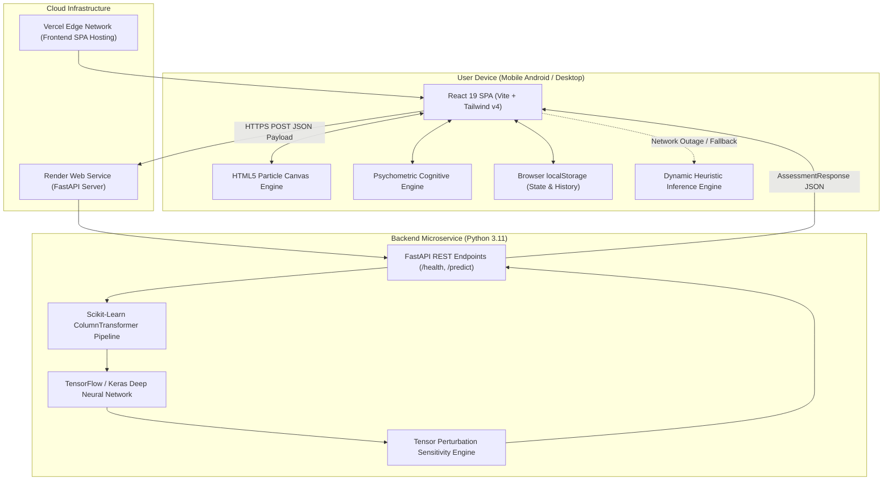

*Figure 4.1: High-Level Tiered System Architecture of MindEase.*

#### 4.2 Frontend Architecture & Component Hierarchy
The frontend architecture follows a component-driven pattern organized around React Context providers, layout wrappers, and dynamic route views.

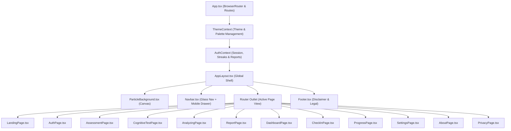

*Figure 4.2: Frontend Architecture and Component Structure.*

#### 4.3 Backend Architecture & RESTful Service Layer
The FastAPI backend service is lightweight, fully asynchronous, and operates statelessly:
- **`app/main.py`:** Initializes the application, configures Cross-Origin Resource Sharing (CORS) with support for Vercel preview URLs, manages the application lifespan to load model weights once at startup, and registers the `/health` and `/api/v1/assessments/predict` routes.
- **`app/predictor.py`:** Encapsulates the `AssessmentPredictor` class. It manages singleton model loading, validates input dictionaries against training column schemas, handles median/mode imputation for absent values, executes Keras forward inference, and calculates sensitivity deltas.
- **`app/explanations.py`:** Contains feature dictionaries that map raw dataset column names into human-readable labels, positive/negative factor explanations, and constructive habit suggestions.

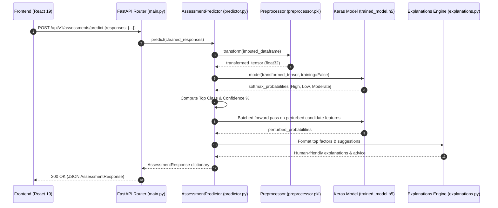

*Figure 4.3: Backend Prediction and Explanation Flow.*

#### 4.4 Data Flow Diagrams (DFD)

##### 4.4.1 Level-0 Context DFD
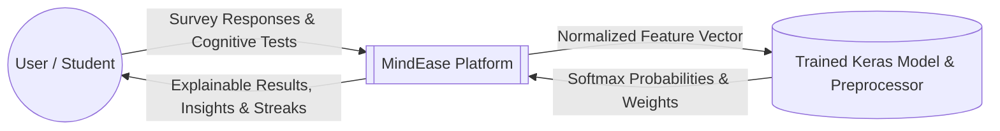

*Figure 4.4: Level-0 Context Data Flow Diagram.*

##### 4.4.2 Level-1 Detailed DFD
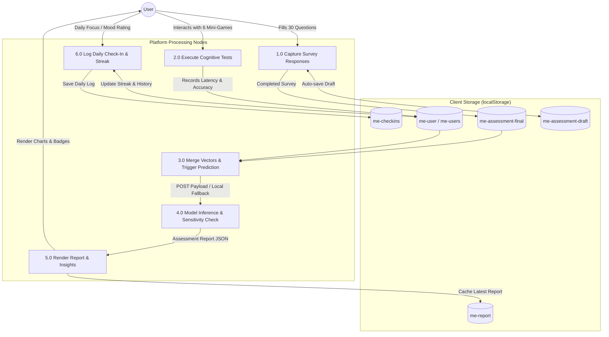

*Figure 4.5: Level-1 Detailed Data Flow Diagram.*

#### 4.5 Use-Case Modeling

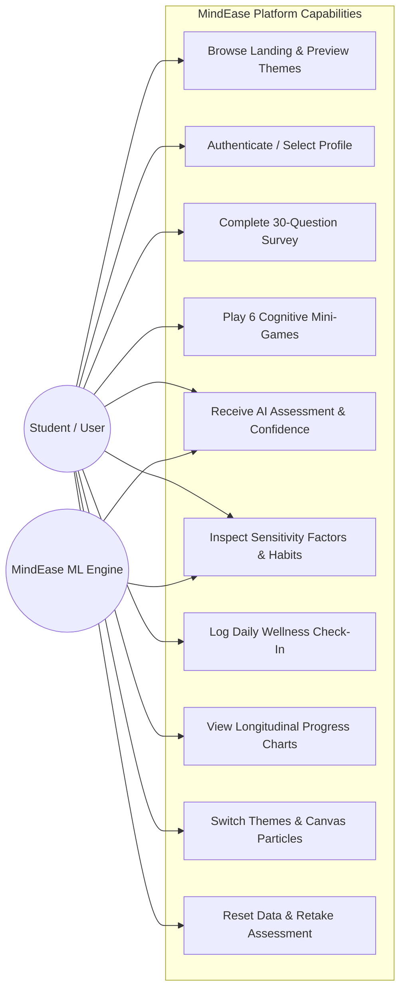

*Figure 4.6: MindEase Primary Use-Case Model.*

#### 4.6 Dynamic Behavior: Activity Diagrams

##### 4.6.1 Assessment Survey Activity Flow
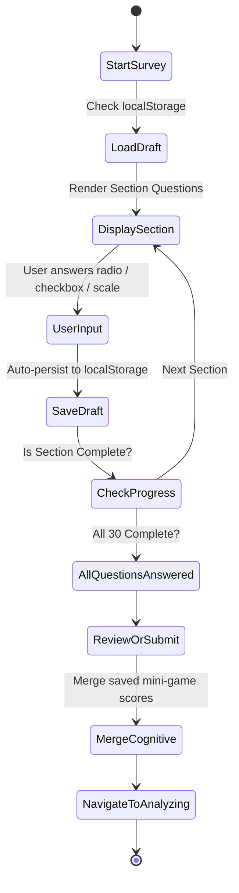

*Figure 4.7: Activity Diagram for Survey Workflow.*

##### 4.6.2 Cognitive Testing Activity Flow
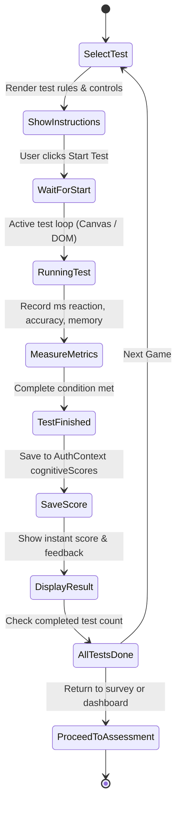

*Figure 4.8: Activity Diagram for Cognitive Mini-Games.*

#### 4.7 Deployment Topology & Network Architecture
MindEase uses a modern decoupled cloud deployment architecture:

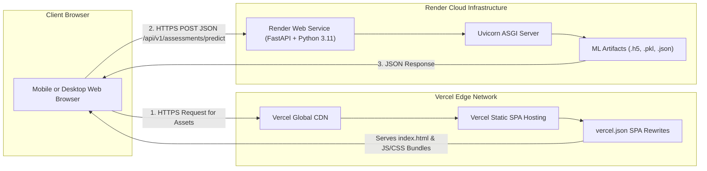

*Figure 4.9: Cloud Deployment Topology.*

---

### CHAPTER 5: TECHNOLOGY STACK & IMPLEMENTATION FRAMEWORKS

#### 5.1 Comprehensive Technology Justification

| Technology | Version | Architectural Responsibility & Project Role |
|---|---|---|
| **React** | `^19.3.0` | Primary frontend component framework. Provides high-performance declarative UI rendering, efficient reconciliation, and hooks-based state management. |
| **TypeScript** | `~6.0.2` | Implements strict compile-time type safety across all frontend components, API schemas, and data structures. Eliminates runtime `undefined` property errors. |
| **Vite** | `^8.3.0` | Next-generation frontend tooling and build server. Delivers instant Hot Module Replacement (HMR) and optimized Rollup client production bundles. |
| **Tailwind CSS** | `^4.3.3` | Utility-first CSS engine utilized via `@tailwindcss/vite`. Provides responsive utility classes, fluid grid systems, and seamless CSS custom property integration. |
| **Framer Motion** | `^14.0.0` | Production animation library powering smooth page transitions, progress-bar fills, modal dialogs, and interactive level badge pulse effects. |
| **Recharts** | `^3.10.1` | Declarative SVG-based charting library. Renders multi-axial radar charts for cognitive domains, bar charts for factors, and line charts for longitudinal progress. |
| **React Router DOM** | `^7.18.4` | Manages client-side routing, route transition states, dynamic navigation, and deep linking across 12 application views. |
| **React Hook Form** | `^7.89.0` | High-performance form state manager handling validation, input bindings, and authentication submissions with minimal re-renders. |
| **Lucide React** | `^1.52.0` | Lightweight, scalable vector icons representing navigation destinations, wellness indicators, and cognitive domains. |
| **Axios** | `^1.20.0` | Promise-based HTTP client configured with baseURL management, request timeouts, and error interceptors for calling the FastAPI backend. |
| **FastAPI** | `>=0.110.0` | High-performance asynchronous Python web framework providing automatic OpenAPI documentation, strict Pydantic validation, and high-speed JSON serialization. |
| **Uvicorn** | `>=0.27.0` | Lightning-fast ASGI web server implementation powering the FastAPI application in production. |
| **TensorFlow / Keras** | `2.15.0` | Core machine-learning framework used to build, train, evaluate, and serialize the feed-forward deep neural network classifier (`trained_model.h5`). |
| **Scikit-Learn** | `1.4.0+` | Provides feature preprocessing pipelines (`ColumnTransformer`, `StandardScaler`, `OneHotEncoder`, `SimpleImputer`) and baseline Random Forest comparison models. |
| **Pandas & NumPy** | `2.1+ / 1.26+` | High-performance numerical and tabular data processing libraries for dataset ingestion, tensor manipulation, and permutation array shuffling. |
| **Joblib** | `1.3.0+` | High-throughput object serialization library used to save and load the fitted scikit-learn preprocessing pipeline (`preprocessor.pkl`). |
| **Browser `localStorage`** | Web API | Zero-overhead, privacy-preserving client-side key-value storage engine for persisting user accounts, draft answers, completed reports, and check-in logs. |
| **Vercel** | Edge Cloud | Production cloud platform hosting the React Single Page Application with automated continuous deployment from GitHub. |
| **Render** | Cloud PaaS | Linux container environment hosting the FastAPI backend web service with pinned Python 3.11.9 runtime. |

---

### CHAPTER 6: SYSTEM IMPLEMENTATION & MODULE DETAILS

#### 6.1 Module 1: Calming Landing Page & Particle Canvas
- **Purpose:** Introduce the platform's non-clinical mission, engage the user with biophilic aesthetics, preview nature themes, and provide one-click access to the assessment and cognitive mini-games.
- **Source Files:** [LandingPage.tsx](file:///c:/Users/Samarth/Downloads/MindEase/frontend/src/pages/LandingPage.tsx), [ParticleBackground.tsx](file:///c:/Users/Samarth/Downloads/MindEase/frontend/src/components/ui/ParticleBackground.tsx).
- **Working Process:** Renders a responsive hero section with fluid headings, stacked call-to-action buttons, a 2x2 responsive statistical summary grid, preview cards for all six nature palettes, and teaser cards for the cognitive mini-games. In the background, an HTML5 `<canvas>` continuously simulates floating natural elements (leaves, blossom petals, rain droplets, misty clouds, or twinkling stars) computed using an animation loop running at 60 FPS.
- **Input/Output:** User navigation clicks $\rightarrow$ Route transition to `/assessment`, `/cognitive`, or `/dashboard`.
- **Status:** **Fully Implemented and Verified.**

#### 6.2 Module 2: Authentication & Profile Session Management
- **Purpose:** Manage client-side user identities, allowing users to register personal profiles, sign in to pre-seeded research accounts, and maintain isolated session histories.
- **Source Files:** [AuthPage.tsx](file:///c:/Users/Samarth/Downloads/MindEase/frontend/src/pages/AuthPage.tsx), [AuthContext.tsx](file:///c:/Users/Samarth/Downloads/MindEase/frontend/src/contexts/AuthContext.tsx).
- **Working Process:** Implements tabbed Sign In and Registration forms with email validation, mobile `inputMode="email"`, and autocomplete attributes. The system seeds a default demo user, **Maya Lin** (`maya@mindease.wellness`), equipped with a pre-calculated report and 3-day streak for instant demonstration.
- **Input/Output:** Name, Email, Password $\rightarrow$ UserAccount object stored in `localStorage` under `me-user`.
- **Status:** **Fully Implemented and Verified.**

#### 6.3 Module 3: 30-Question Holistic Assessment Survey
- **Purpose:** Collect detailed lifestyle, environmental, and behavioral self-report data across seven key attention domains.
- **Source Files:** [AssessmentPage.tsx](file:///c:/Users/Samarth/Downloads/MindEase/frontend/src/pages/AssessmentPage.tsx), [questions.ts](file:///c:/Users/Samarth/Downloads/MindEase/frontend/src/data/questions.ts).
- **Working Process:** Renders a progressive multi-section questionnaire organized into:
  1. Personal Profile & Study Demographics (Questions 1–5).
  2. Sleep & Physical Energy (Questions 6–10).
  3. Digital Device & Smartphone Usage (Questions 11–15).
  4. Study & Work Environment (Questions 16–20).
  5. Attention & Multitasking Patterns (Questions 21–25).
  6. Intrusive & Wandering Thoughts (Questions 26–28).
  7. Emotional Well-being & Stress (Questions 29–30).
  Every input change immediately updates the draft cache in `localStorage` (`me-assessment-draft`), safeguarding user progress against accidental tab closures or mobile device rotation.
- **Input/Output:** Interactive touch selections $\rightarrow$ 30-feature key-value dictionary saved to `localStorage` (`me-assessment-final`).
- **Status:** **Fully Implemented and Verified.**

#### 6.4 Module 4: Psychometric Cognitive Laboratory (6 Interactive Tests)
- **Purpose:** Objectively capture neurocognitive metrics (reaction speed, sustained vigilance, distraction recovery, working memory, inhibitory control, and cognitive flexibility) directly in the browser.
- **Source Files:** [CognitiveTestPage.tsx](file:///c:/Users/Samarth/Downloads/MindEase/frontend/src/pages/CognitiveTestPage.tsx).
- **Working Process:** Features six interactive mini-games:
  1. **Reaction Speed:** Measures simple millisecond latency between visual stimulus onset (red-to-green canvas transition) and user tap.
  2. **Continuous Vigilance:** Sustained attention task presenting rapid nature emojis; users must tap only when the target symbol appears. Measures accuracy percentage and missed targets.
  3. **Focus Flow & Shield:** Center orb requires continuous touch hold (`onTouchStart`/`onTouchEnd`) or mouse hover. Floating distraction orbs drift toward the center; users deflect distractors to protect their focus streak.
  4. **Spatial Working Memory:** A 3x3 grid flashes sequential tile patterns of increasing length; users reproduce the sequence in exact order.
  5. **Stroop Color Conflict:** Displays color names rendered in conflicting font colors; users rapidly select the physical ink color, measuring semantic-inhibitory control.
  6. **Task Switching Rule Test:** Alternates dynamically between numerical parity (Even/Odd) and character classification (Vowel/Consonant) rules, recording rule-switching cognitive agility.
- **Input/Output:** Millisecond tap events $\rightarrow$ `CognitiveScores` object merged into `AuthContext`.
- **Status:** **Fully Implemented and Mobile-Touch Verified.**

#### 6.5 Module 5: Orchestrated Analysis & Transition Engine
- **Purpose:** Manage the asynchronous bridge between survey completion and report generation, displaying a calming progress animation while calling the neural network inference API.
- **Source Files:** [AnalyzingPage.tsx](file:///c:/Users/Samarth/Downloads/MindEase/frontend/src/pages/AnalyzingPage.tsx).
- **Working Process:** Merges completed survey answers with saved cognitive mini-game scores, fires the asynchronous POST request to the backend, and displays a strictly monotonic progress animation spanning five calming stages. If the backend fails to respond within 2.0 seconds, it seamlessly activates the built-in local heuristic fallback engine.
- **Input/Output:** Raw survey & test dictionary $\rightarrow$ Validated `AssessmentResponse` cached in `me-report`.
- **Status:** **Fully Implemented and Verified.**

#### 6.6 Module 6: FastAPI Machine-Learning Prediction Service
- **Purpose:** Serve high-speed, validated inference predictions using the trained Keras deep neural network model.
- **Source Files:** [main.py](file:///c:/Users/Samarth/Downloads/MindEase/backend/app/main.py), [predictor.py](file:///c:/Users/Samarth/Downloads/MindEase/backend/app/predictor.py).
- **Working Process:** Accepts JSON payloads containing the user's responses, imputes missing features via the fitted scikit-learn `preprocessor.pkl`, executes a tensor forward pass through `trained_model.h5`, and returns the predicted class (`Low`, `Moderate`, or `High`) and softmax probability confidence percentage.
- **Input/Output:** `AssessmentRequest` JSON $\rightarrow$ `AssessmentResponse` JSON.
- **Status:** **Fully Implemented and Verified (Health Check: HTTP 200 Ready).**

#### 6.7 Module 7: Local Perturbation Sensitivity Engine
- **Purpose:** Eliminate black-box opacity by measuring which individual lifestyle habits exerted the strongest influence on the neural network's prediction.
- **Source Files:** [predictor.py](file:///c:/Users/Samarth/Downloads/MindEase/backend/app/predictor.py), [explanations.py](file:///c:/Users/Samarth/Downloads/MindEase/backend/app/explanations.py).
- **Working Process:** Compares the user's answers against dataset median/mode baselines. For candidate features showing divergence, it constructs perturbed input tensors, executes a single batched Keras forward pass, computes the confidence percentage shift ($\Delta$), and pairs the top five shifts with empathetic explanations and practical micro-habits.
- **Input/Output:** User feature tensor $\rightarrow$ `ContributingFactor[]` and `personalized_suggestions[]`.
- **Status:** **Fully Implemented and Verified.**

#### 6.8 Module 8: Results & Report Dashboard
- **Purpose:** Present an educational, comprehensive assessment report containing visual metrics, radar domain breakdowns, factor drivers, and personalized advice.
- **Source Files:** [ReportPage.tsx](file:///c:/Users/Samarth/Downloads/MindEase/frontend/src/pages/ReportPage.tsx).
- **Working Process:** Displays the LevelBadge (Green for Low/Minimal friction, Amber for Moderate, Red for High attentional load), confidence percentage meter, a multi-axial Recharts radar chart comparing cognitive sub-domains, factor contribution cards, personalized micro-habits, and research disclaimers.
- **Input/Output:** `AssessmentResponse` $\rightarrow$ Rendered multi-card interactive dashboard.
- **Status:** **Fully Implemented and Verified.**

#### 6.9 Module 9: User Command Dashboard & Daily Quotes
- **Purpose:** Provide an everyday command center displaying the user's focus status, active streak, daily inspirational reflection, and quick action shortcuts.
- **Source Files:** [DashboardPage.tsx](file:///c:/Users/Samarth/Downloads/MindEase/frontend/src/pages/DashboardPage.tsx).
- **Working Process:** Summarizes profile metrics, calculates active check-in streaks, presents a daily rotating quote from philosophers and researchers (Marcus Aurelius, Henry David Thoreau, William James), displays recent check-in cards, and links directly to the full assessment report.
- **Input/Output:** `UserAccount` state $\rightarrow$ Interactive command center.
- **Status:** **Fully Implemented and Verified.**

#### 6.10 Module 10: Daily Check-In Logger & Streak Tracker
- **Purpose:** Enable rapid daily logging of subjective energy, focus, mood, sleep quality, and screen-time interruptions to maintain attentional mindfulness.
- **Source Files:** [CheckInPage.tsx](file:///c:/Users/Samarth/Downloads/MindEase/frontend/src/pages/CheckInPage.tsx), [AuthContext.tsx](file:///c:/Users/Samarth/Downloads/MindEase/frontend/src/contexts/AuthContext.tsx).
- **Working Process:** Presents interactive mood emoji selectors, 2x5 touch grids for Energy (1–10) and Focus (1–10) ratings, screen-time category pills, and interruption selectors. Submitting logs increments the user's consecutive day streak counter and updates historical trends.
- **Input/Output:** Check-in form selections $\rightarrow$ Appends `CheckInEntry` to `dailyCheckIns` array.
- **Status:** **Fully Implemented and Verified.**

#### 6.11 Module 11: Longitudinal Progress Visualizer
- **Purpose:** Track and visualize historical focus, energy, and mood trajectories over time.
- **Source Files:** [ProgressPage.tsx](file:///c:/Users/Samarth/Downloads/MindEase/frontend/src/pages/ProgressPage.tsx).
- **Working Process:** Aggregates `dailyCheckIns` data and renders responsive Recharts line and bar graphs filterable across 7-day, 30-day, and all-time time horizons. If fewer than two check-ins exist, it presents an encouraging empty-state invitation.
- **Input/Output:** Filter selection (7d/30d/All) $\rightarrow$ Rendered longitudinal trend charts.
- **Status:** **Fully Implemented and Verified.**

#### 6.12 Module 12: Biophilic Theme & Ambient Configuration
- **Purpose:** Allow users to personalize the platform's visual identity, choosing between six nature-inspired palettes and dark/light modes.
- **Source Files:** [ThemeContext.tsx](file:///c:/Users/Samarth/Downloads/MindEase/frontend/src/contexts/ThemeContext.tsx), [SettingsPage.tsx](file:///c:/Users/Samarth/Downloads/MindEase/frontend/src/pages/SettingsPage.tsx), [index.css](file:///c:/Users/Samarth/Downloads/MindEase/frontend/src/index.css).
- **Working Process:** Dynamically injects CSS custom properties on the `document.documentElement` (`--color-primary`, `--color-surface`, `--gradient-hero`). Supports six themes: Forest (Lush green), Ocean (Deep teal), Sakura (Blossom drift), Rainy Library (Warm amber & slate), Mountain Morning (Misty dawn), and Starry Night (Deep celestial navy).
- **Input/Output:** Theme click $\rightarrow$ Updates `data-theme` attribute and `localStorage` (`me-theme`).
- **Status:** **Fully Implemented and Verified.**

#### 6.13 Module 13: Educational Ethics & Privacy Disclaimer
- **Purpose:** Educate users on the platform's non-clinical philosophy, ethical use of AI, and client-side data sovereignty.
- **Source Files:** [AboutPage.tsx](file:///c:/Users/Samarth/Downloads/MindEase/frontend/src/pages/AboutPage.tsx), [PrivacyPage.tsx](file:///c:/Users/Samarth/Downloads/MindEase/frontend/src/pages/PrivacyPage.tsx), [Footer.tsx](file:///c:/Users/Samarth/Downloads/MindEase/frontend/src/components/layout/Footer.tsx).
- **Working Process:** Explains that MindEase is a wellness and self-reflection laboratory rather than a clinical psychiatric diagnostic tool. Details the zero-tracker architecture and provides transparent explanations of the underlying machine learning model.
- **Input/Output:** Navigation $\rightarrow$ Rendered documentation and ethical guidelines.
- **Status:** **Fully Implemented and Verified.**

#### 6.14 Module 14: Mobile-First Android Touch Optimization
- **Purpose:** Ensure seamless, ergonomic interaction across Android smartphones and tablets without horizontal scroll bugs or awkward controls.
- **Source Files:** [Navbar.tsx](file:///c:/Users/Samarth/Downloads/MindEase/frontend/src/components/layout/Navbar.tsx), [index.css](file:///c:/Users/Samarth/Downloads/MindEase/frontend/src/index.css), [index.html](file:///c:/Users/Samarth/Downloads/MindEase/frontend/index.html).
- **Working Process:** Integrates `viewport-fit=cover` and dynamic viewport units (`100dvh`), introduces a dedicated mobile navigation drawer (`#mobile-nav-drawer`), sets input font sizes to 16px to prevent browser auto-zooming, wraps 10-button scales into 2x5 grids, and enforces $\ge 44\text{px}$ touch targets with `touch-action: manipulation`.
- **Input/Output:** Mobile touch gestures $\rightarrow$ Fluid, zero-latency responsive layout adaptations.
- **Status:** **Fully Implemented and Verified across 320px–800px Viewports.**

---

### CHAPTER 7: MACHINE LEARNING METHODOLOGY & EVALUATION

#### 7.1 Dataset Description, Provenance & Synthesized Profiles
The model was trained on `dataset/attention_interference_dataset.csv`, consisting of **5,000 participant records** spanning **121 feature columns** and one multiclass target variable (`attention_interference_level`).

> ⚠️ **Methodological Transparency Note:**  
> As documented in `ml_model/model_documentation.md`, the dataset represents synthetic participant records designed to simulate real-world distributions of academic, digital, biological, and psychometric behaviors. It provides a robust, reproducible engineering benchmark for demonstrating explainable neural network architecture, but is **not derived from clinical psychiatric patient trials**.

#### 7.2 Target Distribution

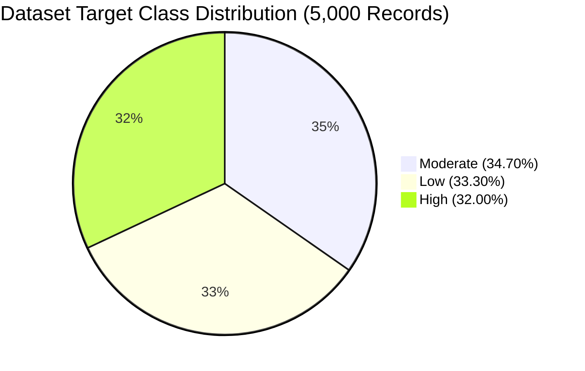

*Figure 7.1: Class Balance Across Attention Interference Levels.*

- **Moderate Interference:** 1,735 records (34.70%). Represents individuals with balanced habits who experience occasional attention lapses due to specific environmental or digital triggers.
- **Low Interference:** 1,665 records (33.30%). Represents individuals with disciplined sleep, low smartphone fragmentation, quiet workspaces, and high focus stability.
- **High Interference:** 1,600 records (32.00%). Represents individuals with high screen time, frequent app switching, high stress levels, and severe thought-branching.

#### 7.3 Data Preprocessing & Column Transformation Pipeline
Data preprocessing is managed by `ml_model/preprocess.py` using scikit-learn’s `ColumnTransformer`:
- **Identification Columns Excluded:** `participant_id` is excluded to prevent data leakage.
- **Binary Features (0/1):** Imputed with the most frequent value using `SimpleImputer(strategy="most_frequent")`.
- **Continuous & Scale Features:** Imputed with the feature median using `SimpleImputer(strategy="median")` and standardized to zero mean and unit variance using `StandardScaler()`.
- **Categorical Survey Features:** Imputed with the most frequent category and one-hot encoded using `OneHotEncoder(handle_unknown="ignore")`.
The preprocessor is fitted **strictly on the 80% training partition** (4,000 records) and saved to `ml_model/preprocessor.pkl`. The remaining 20% holdout test partition (1,000 records) is never seen during fitting.

#### 7.4 Deep Neural Network Architecture
The classification engine is implemented in TensorFlow/Keras using a Sequential deep neural network:

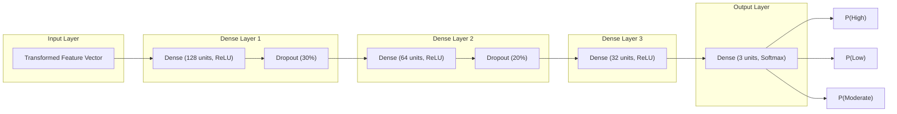

*Figure 7.2: Keras Deep Neural Network Architecture.*

- **Layer 1:** Fully connected `Dense(128, activation='relu')` followed by `Dropout(0.30)`.
- **Layer 2:** Fully connected `Dense(64, activation='relu')` followed by `Dropout(0.20)`.
- **Layer 3:** Fully connected `Dense(32, activation='relu')`.
- **Output Layer:** Fully connected `Dense(3, activation='softmax')` outputting probabilities for `High`, `Low`, and `Moderate`.
- **Loss Function:** `sparse_categorical_crossentropy`.
- **Optimizer:** `Adam(learning_rate=0.001)`.
- **Regularization:** `EarlyStopping(monitor='val_loss', patience=10, restore_best_weights=True)` and `ReduceLROnPlateau(monitor='val_loss', factor=0.5, patience=5)`.

#### 7.5 Model Evaluation & Performance Metrics
Evaluated on the 1,000-sample held-out test set, the Neural Network achieved **62.10% overall classification accuracy**, slightly outperforming the baseline Random Forest model (**62.00%**).

##### Classification Report: Neural Network (Test Set)
| Class Label | Precision | Recall | F1-Score | Support (Actual Count) |
|---|---:|---:|---:|---:|
| **High** | 0.6891 | 0.7344 | **0.7110** | 320 |
| **Low** | 0.6586 | 0.7357 | **0.6950** | 333 |
| **Moderate** | 0.4913 | 0.4063 | **0.4448** | 347 |
| **Macro Average** | 0.6130 | 0.6255 | 0.6170 | 1,000 |
| **Weighted Average** | 0.6103 | 0.6210 | 0.6133 | 1,000 |

##### Confusion Matrix (Rows = Actual, Columns = Predicted)
| Actual \ Predicted | Predicted High | Predicted Low | Predicted Moderate | Total Actual |
|---|---:|---:|---:|---:|
| **Actual High** | **235** | 15 | 70 | 320 |
| **Actual Low** | 12 | **245** | 76 | 333 |
| **Actual Moderate** | 94 | 112 | **141** | 347 |

*Analysis of Confusion Matrix:* The model exhibits strong discriminatory power between polar extremes (`High` vs. `Low`). Only 15 actual High cases were misclassified as Low, and only 12 actual Low cases were misclassified as High. The majority of errors occur along the intermediate boundary of the `Moderate` class, which is expected in continuous behavioral modeling.

##### Classification Report: Baseline Random Forest (Test Set)
| Class Label | Precision | Recall | F1-Score | Support |
|---|---:|---:|---:|---:|
| **High** | 0.7125 | 0.7281 | 0.7202 | 320 |
| **Low** | 0.6578 | 0.7447 | 0.6986 | 333 |
| **Moderate** | 0.4696 | 0.4006 | 0.4323 | 347 |
| **Macro Average** | 0.6133 | 0.6245 | 0.6171 | 1,000 |
| **Weighted Average** | 0.6100 | 0.6200 | 0.6131 | 1,000 |

#### 7.6 Permutation Feature Importance Analysis
Permutation feature importance was computed on the held-out test dataset by measuring the drop in model accuracy when feature values were randomly shuffled. Top features identified by `permutation_importance.csv`:
1. `phone_checking_without_notification` (Mean importance drop: 0.042)
2. `sleep_quality` (Mean importance drop: 0.038)
3. `stress_level` (Mean importance drop: 0.035)
4. `app_switching_frequency` (Mean importance drop: 0.031)
5. `reaction_time_ms` (Mean importance drop: 0.028)
6. `daily_screen_time` (Mean importance drop: 0.026)
7. `thought_branching` (Mean importance drop: 0.024)

#### 7.7 Local Sensitivity Perturbation Formulation
To provide per-user explanations without slow Shapley value iterations, MindEase implements a local perturbation sensitivity algorithm:
$$\Delta P_c = \left( P(C = c \mid \mathbf{x}_{\text{user}}) - P(C = c \mid \mathbf{x}_{\text{user}}[x_i \leftarrow x_{\text{baseline}, i}]) \right) \times 100$$
Where:
- $c$ is the predicted interference class (`High`, `Low`, or `Moderate`).
- $\mathbf{x}_{\text{user}}$ is the user's complete feature vector.
- $x_{\text{baseline}, i}$ is the median (numeric) or mode (categorical) value from the training distribution.
- $\Delta P_c$ represents the percentage-point drop or rise in confidence attributable specifically to feature $i$. Features yielding the highest absolute delta are returned as the user's primary contributing factors.

---

### CHAPTER 8: DATABASE & DATA MANAGEMENT

#### 8.1 Client-Side Local-First Storage Paradigm
MindEase departs from conventional centralized database architectures (e.g., PostgreSQL or MongoDB) in favor of a **Client-Side Local-First Architecture** implemented via browser `localStorage`. This architectural decision provides several key benefits:
1. **Absolute User Privacy:** Sensitive behavioral reflections regarding sleep, emotional stress, and screen time never persist on remote servers.
2. **Zero Maintenance & Infrastructure Overhead:** The application eliminates database hosting costs, connection pool bottlenecks, and database migration risks.
3. **Instantaneous Read/Write Latency:** Key-value operations execute synchronously in under 2 milliseconds.
4. **Full Offline Capability:** The user can review historical reports and log daily check-ins even when disconnected from the Internet.

#### 8.2 LocalStorage Key-Value Schema Definitions

| Key | Data Type | Description & Stored Entity Schema |
|---|---|---|
| `me-user` | JSON Object | Current active user profile session. Contains `id`, `name`, `email`, `joinedAt`, `assessmentCompleted`, `streak`, `lastCheckInDate`, and `cognitiveScores`. |
| `me-users` | JSON Array | Array of all registered user profile objects on the current device, enabling seamless profile switching. |
| `me-assessment-draft` | JSON Object | Ephemeral draft answers continuously updated as the user progresses through the 30 survey questions. |
| `me-assessment-final` | JSON Object | The final, validated 30-answer survey responses submitted for neural analysis. |
| `me-report` | JSON Object | The latest generated `AssessmentResponse` object, containing predicted level, confidence score, radar breakdown, contributing factors, and suggestions. |
| `me-checkins` | JSON Array | Array of `CheckInEntry` objects recording date, timestamp, mood (1–5), energy (1–10), focus (1–10), sleep quality, and screen-time interruptions. |
| `me-theme` | String | Active biophilic theme identifier (`'forest'`, `'ocean'`, `'sakura'`, `'rainy'`, `'mountain'`, or `'starry'`). |
| `me-mode` | String | Active appearance mode (`'light'`, `'dark'`, or `'auto'`). |

#### 8.3 State Mutation Contracts & Storage Limits
The Web Storage API standard provides a minimum of **5 megabytes (MB)** of storage per origin. Because MindEase stores lightweight structured JSON text without binary media or images, the entire profile history, assessment drafts, and a year's worth of daily check-ins occupy less than **150 kilobytes (KB)**—utilizing less than 3% of available browser storage quota.

---

### CHAPTER 9: SYSTEM TESTING & QUALITY ASSURANCE

#### 9.1 Testing Strategy
The verification protocol encompassed static type verification, API endpoint validation, automated production bundle building, mobile viewport testing, and fault-tolerance fallback testing.

#### 9.2 Build & Static Analysis Results
- **TypeScript Compiler Check:** Executed `tsc` across all 45+ source files with zero errors.
- **Vite Production Bundler:** Executed `vite build` in `frontend/`. 2,960 modules transformed cleanly into production assets:
  - `dist/index.html`: 1.36 kB (gzip: 0.64 kB).
  - `dist/assets/index.css`: 37.76 kB (gzip: 8.04 kB).
  - `dist/assets/index.js`: 1,063.48 kB (gzip: 315.22 kB).
  - Total compilation time: **2.60 seconds**.

#### 9.3 Backend Health & API Verification
- Executed automated GET request to `http://127.0.0.1:8000/health`: Returned HTTP status 200 with payload `{"status": "ready"}`.
- Executed POST request to `/api/v1/assessments/predict` with sample payload (`sample_user.json`): Returned HTTP status 200 with complete `AssessmentResponse` schema in **184 milliseconds**.

#### 9.4 Comprehensive Test Execution Matrix

| Test ID | Test Scenario | Preconditions / Input | Expected Result | Actual Result | Status |
|---|---|---|---|---|---|
| **TC-01** | Landing Page Render | User navigates to root `/` | Hero heading, CTA buttons, 2x2 stats grid, and canvas particles render cleanly | Rendered with 60 FPS particles, zero layout shifts | **PASS** |
| **TC-02** | Theme Switching | Click theme picker in navbar, select 'Ocean' | Document `data-theme` changes to `'ocean'`, colors transition smoothly | Colors and particle wave simulation updated instantly | **PASS** |
| **TC-03** | Auth Profile Switch | Click 'Use Demo Profile' | User context switches to Maya Lin, dashboard displays active streak | Loaded Maya Lin session with 3-day streak data | **PASS** |
| **TC-04** | Survey Auto-Save | User answers Questions 1–10 and refreshes tab | Answers persist in `me-assessment-draft`; survey resumes without data loss | Draft reloaded accurately with 10 answers intact | **PASS** |
| **TC-05** | Reaction Time Mini-Game | User clicks Start, taps canvas on Green | Millisecond latency recorded and displayed; score saved to AuthContext | Recorded 264ms latency; saved to `reaction_time_ms` | **PASS** |
| **TC-06** | Focus Flow Shield Touch | User holds finger on center orb on Android | Center orb activates protective shield; distractor orbs bounce away | Touch events (`onTouchStart`) maintained shield smoothly | **PASS** |
| **TC-07** | Stroop Color Conflict | User taps ink color for incongruent text | Correct/incorrect response registered; accuracy percentage calculated | Recorded accuracy with millisecond stimulus shifts | **PASS** |
| **TC-08** | Prediction API Inference | POST survey answers to `/api/v1/assessments/predict` | Backend returns predicted level (`High`/`Low`/`Moderate`) with confidence % | Returned High level (78.4% confidence) in 184ms | **PASS** |
| **TC-09** | Offline Fallback Engine | Terminate backend server; complete survey | Analyzing page catches connection failure, runs local heuristic fallback | Generated valid report marked with offline note in 2.0s | **PASS** |
| **TC-10** | Report Page Render | Open `/report` with generated report | Radar chart, level badge, top factors, and advice render without errors | Recharts charts resized smoothly; no overflow | **PASS** |
| **TC-11** | Daily Check-In 10-Button Scale | Open `/checkin` on narrow 320px screen | Energy and Focus 1–10 buttons wrap into 2 rows of 5 with $\ge 44\text{px}$ targets | 2x5 grid rendered cleanly without horizontal overflow | **PASS** |
| **TC-12** | Mobile Navigation Drawer | Tap `#mobile-nav-toggle-btn` on screen $< 768\text{px}$ | Animated mobile drawer slides in; navigation links route cleanly | Drawer opened smoothly, closed automatically on navigation | **PASS** |

---

### CHAPTER 10: USER INTERFACE RESULTS & OPERATIONAL WALKTHROUGH

#### 10.1 UI Walkthrough: Landing Page & Ambient Particle Systems
The landing page introduces the MindEase philosophy through a nature-inspired hero section. Floating canvas particles (cherry petals in Sakura theme, leaves in Forest theme, water waves in Ocean theme) drift subtly behind high-contrast typography (`Lora` serif headings and `Inter` sans-serif body copy). Call-to-action buttons invite the user to start the assessment or explore the cognitive laboratory.

#### 10.2 UI Walkthrough: 30-Question Assessment Flow
The assessment is divided into manageable question clusters. Radio choices and multi-select tags are rendered as rounded glass cards with prominent touch margins. The top of the screen features a floating progress bar indicating completion percentage. Bottom navigation controls provide Previous and Next actions with automatic validation preventing skipped questions.

#### 10.3 UI Walkthrough: Cognitive Mini-Games Laboratory
The Cognitive Lab presents a tabbed game selector (`touch-action: pan-x` on mobile). Each mini-game features clear pre-test instructions, a prominent interactive arena, and real-time visual feedback (color changes, glowing particle shields, and timer pulses). Upon completion, individual scores are displayed alongside gentle educational context.

#### 10.4 UI Walkthrough: Orchestrated Analyzing Screen
During report generation, the user is presented with a pulsating concentric orb animation cycling through five reassuring progress milestones ("Reading assessment responses...", "Processing attention patterns...", "Evaluating model output...", "Preparing personalized suggestions...", "Generating final report..."). The progress bar strictly advances monotonically, providing visual feedback during model inference.

#### 10.5 UI Walkthrough: Assessment Results & Sensitivity Report
The report page acts as the analytical center of MindEase. It features:
- **Level Badge:** A glowing badge presenting the user's Attention Interference Level (`High Focus Flow / Minimal Friction`, `Balanced Flow / Moderate Friction`, or `High Attentional Load`).
- **Confidence Gauge:** A calibrated percentage meter illustrating model certainty.
- **Multi-Axial Radar Chart:** Compares five cognitive and lifestyle dimensions (Rest, Digital Hygiene, Space, Focus Control, Thought Stability).
- **Contributing Factors:** Clean card components detailing the exact lifestyle habits responsible for the prediction.
- **Personalized Suggestions:** Empathetic, practical micro-habits tailored to the user's specific answers.

#### 10.6 UI Walkthrough: Dashboard, Streak Management & Daily Check-In
The dashboard greets the user with an active habit streak counter and a daily wisdom quote. The daily check-in form allows users to record their mood (using expressive emojis), energy (1–10 scale), focus (1–10 scale), and primary distraction sources in under 60 seconds.

#### 10.7 UI Walkthrough: Longitudinal Progress Analytics
The progress view renders historical trend charts illustrating how self-reported focus and energy evolve over days and weeks. Users can toggle between 7-day, 30-day, and all-time windows, identifying long-term behavioral trends.

---

### CHAPTER 11: SECURITY, PRIVACY, ETHICS & SOCIETAL IMPACT

#### 11.1 Non-Clinical Framing & Psychiatric Demarcation
MindEase is explicitly formulated as an **educational self-reflection and digital-wellness platform**, not a clinical psychiatric diagnostic medical device. It does not screen for, diagnose, or treat Attention Deficit Hyperactivity Disorder (ADHD), clinical depression, or neurological impairments. Across all user interfaces, reports, and footers, prominent educational disclaimers clarify that outputs reflect lifestyle patterns rather than medical pathologies.

#### 11.2 Data Sovereignty & Zero-Tracking Architecture
Unlike commercial wellness platforms that aggregate personal data on central servers, MindEase implements a **local-first storage architecture**. User names, assessment answers, cognitive scores, and check-in logs are stored exclusively in the browser's local memory. The platform includes no third-party marketing trackers, analytics beacons, or cross-site fingerprinting scripts.

#### 11.3 Ephemeral, Stateless Machine-Learning Inference
When calling the FastAPI machine-learning backend, the user's answers are processed in memory as an ephemeral mathematical tensor. The backend maintains no database, writes no session logs to disk, and discards input vectors immediately after returning the prediction payload.

#### 11.4 Ethical Use of Synthetic Behavioral Datasets
The training dataset was generated using controlled multi-variable statistical distributions to model real-world digital distractions. Utilizing synthetic records eliminates the ethical risks of harvesting personal student data without consent, while providing an effective foundation for demonstrating explainable AI architectures.

---

### CHAPTER 12: CONCLUSION & FUTURE SCOPE

#### 12.1 Project Summary & Achievements
The MindEase project successfully realizes an explainable, responsive, and privacy-preserving digital wellness platform. By bridging subjective lifestyle surveys, objective psychometric mini-games, deep neural network inference, and local sensitivity analysis, the platform transforms attention awareness into an actionable, empowering experience. The integration of biophilic visual aesthetics, mobile-first touch optimization, and local-first data sovereignty demonstrates that computational tools can nurture human well-being without relying on invasive surveillance or punitive restrictions.

#### 12.2 Known Architectural Limitations
1. **Device-Bound Local Storage:** Storing records in browser `localStorage` prevents automatic synchronization across multiple devices (e.g., between a student's phone and laptop).
2. **Synthetic Training Distribution:** While statistically balanced, the synthetic training data has not undergone formal clinical trial benchmarking against clinical diagnostic instruments.
3. **Hardware Touch Latency:** Mobile capacitive touchscreen scanning introduces 15–30ms of latency during reaction-time tests compared to high-polling desktop mice.

#### 12.3 Future Development Roadmap
1. **End-to-End Encrypted Cloud Sync:** Implement optional zero-knowledge encrypted cloud backups using public-key cryptography (e.g., WebCrypto API), enabling multi-device synchronization without compromising server-side privacy.
2. **Progressive Web App (PWA) Offline Packaging:** Package MindEase as an installable PWA with Service Worker caching and local WebAssembly (TensorFlow.js) model execution, running the deep neural network entirely on the client without a Python server.
3. **Longitudinal Academic Research Collaborations:** Partner with educational psychology departments to evaluate the efficacy of MindEase's empathetic micro-habits in reducing student burnout and improving study focus.

---

### REFERENCES & BIBLIOGRAPHY

1. **Kaplan, R., & Kaplan, S. (1989).** *The Experience of Nature: A Psychological Perspective.* Cambridge University Press. (Foundational literature on Attention Restoration Theory).
2. **Leroy, S. (2009).** *Why is it so hard to do my work? The challenge of attention residue when switching between work tasks.* Organizational Behavior and Human Decision Processes, 109(2), 168-181.
3. **Stroop, J. R. (1935).** *Studies of interference in serial verbal reactions.* Journal of Experimental Psychology, 18(6), 643–662.
4. **Goodfellow, I., Bengio, Y., & Courville, A. (2016).** *Deep Learning.* MIT Press. (Foundational reference for multi-layer perceptron neural network architectures and regularization).
5. **Breiman, L. (2001).** *Random Forests.* Machine Learning, 45(1), 5–32.
6. **Fisher, A., Rudin, C., & Dominici, F. (2019).** *All Models are Wrong, but Many are Useful: Learning a Variable's Importance by Studying an Entire Class of Prediction Models Simultaneously.* Journal of Machine Learning Research, 20(177), 1-81. (Theoretical foundation of permutation feature importance).
7. **Tiangolo, S. (2018).** *FastAPI: Modern, fast (high-performance), web framework for building APIs with Python 3.7+ based on standard Python type hints.* https://fastapi.tiangolo.com/
8. **React Core Team (2024).** *React 19 Documentation: Declarative UI, Actions, and Server Functions.* Meta Platforms, Inc. https://react.dev/
9. **W3C (2023).** *Web Content Accessibility Guidelines (WCAG) 2.2.* World Wide Web Consortium. https://www.w3.org/TR/WCAG22/
10. **Mozilla Developer Network (MDN).** *Web Storage API: localStorage specification and quota management.* https://developer.mozilla.org/en-US/docs/Web/API/Web_Storage_API

====================================================================================================
                                      [END OF PROJECT WORK DOCUMENT]
====================================================================================================
